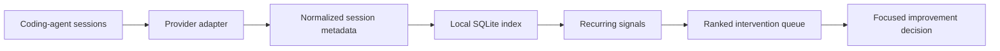

<p align="center">
  
</p>

# Muninn

**Find the next improvement in your coding-agent workflow.**

Muninn is a local CLI for finding avoidable cost and friction in coding-agent
work. It examines normalized session metadata across completed tasks, identifies
recurring patterns in tooling, instructions, discovery, verification, and
delivery, then returns a bounded list of the changes most worth investigating.

Analysis runs on your machine, using local session files and a local SQLite
index.

> **Status:** Codex and Claude Code are supported session providers
> (`--provider codex`, the default, and `--provider claude`). The analysis,
> storage, findings, and reporting model are provider-neutral so other harnesses
> can add a discovery and normalization adapter without changing the core.

## From session exhaust to an improvement decision

Imagine a repository where agent work is expensive, but nobody knows why:

```sh
muninn analyze --repo . --since 7d --compare previous
```

Muninn returns compact JSON with a ranked, consolidated intervention queue. An
intervention identifies the recurring signal, the locally controlled tool,
workflow, or owner it concerns, the confidence and priority of the evidence,
and the next bounded analytical view to inspect. You can then focus on one
concern rather than rereading every session:

```sh
muninn analyze --repo . --focus tooling
muninn analyze --repo . --focus discovery
muninn analyze --repo . --operation repository-cli/test --details
muninn failures repository-cli/test --repo . --since 14d
```

The goal is not to optimize every command. It is to make the next system-level
improvement clear: fix an owned tool's failure contract, combine a recurring
workflow, tighten an instruction route, reduce an output-heavy operation, add a
focused verification step, or leave a healthy pattern alone.



## What Muninn looks for

Muninn treats recurring, attributable patterns as evidence—not proof of
causality. It keeps different improvement levers separate so the result points
at the part of the system that can actually change.

| Area | Examples of useful signals |
| --- | --- |
| Tooling | Repeated owned-operation failures, opaque non-zero exits, unchanged retries, truncation, oversized output, and lower-level bypasses. |
| Workflow | Recurrent cross-call operation chains, rapid continuation polling, expensive inline scripts, and missing combined commands. |
| Instructions and context | Oversized always-on guidance, repeated skill reloads, weak routes from repository instructions to authoritative owners, and compaction pressure. |
| Discovery | Repeated search bursts that fail to reach a source owner, or repository navigation associated with task cost or rework. |
| Verification and delivery | Broad failures repeatedly followed by focused diagnosis, duplicate checks without edits, and delivery evidence associated with downstream escapes. |
| Cost and quality | Fresh, cached, reasoning, and output tokens; roundtrips; completed-task cohorts; and observed delivery quality. |

Related evidence consolidates into one intervention for the same configured
operation or current code owner. A frequently edited file with no quality or
cost evidence remains healthy demand, not a finding.

## Start locally

Install the CLI with Go:

```sh
go install github.com/coadan/muninn/cmd/muninn@latest
```

Then analyze the current repository's recent work:

```sh
muninn analyze --repo . --since 24h
```

Analyze Claude Code sessions instead with `--provider claude`; Muninn reads
`~/.claude/projects` (or `$CLAUDE_CONFIG_DIR/projects`) unless `--sessions-dir`
says otherwise:

```sh
muninn analyze --provider claude --repo . --since 7d
```

Use a day or week window when comparing an intervention with the immediately
preceding period:

```sh
muninn analyze --repo . --since 1d --compare previous
muninn analyze --repo . --since 7d --compare previous
```

The default output is a compact JSON report. Add `--details` for the full
analytical maps. `muninn failures <tool-or-operation>` provides a bounded,
separately attributed timeline when a configured operation needs diagnosis.

Reports also include a [context profile](docs/analysis.md#context-profile):
first-observed input size, growth between compactions, and observed work after
compaction, with coverage counts wherever session data is incomplete.

## Use evidence to improve the harness

Muninn is most useful as a loop, not a dashboard:

1. Analyze a meaningful cohort of completed tasks.
2. Select one high-confidence, locally controlled intervention.
3. Change the tool, instruction, source owner, or verification workflow it
   identifies.
4. Compare a later day or week against the previous period.
5. Keep, revise, or remove the change based on observed cost and quality.

The comparison is observational. Muninn aligns completed tasks by agent, model,
reasoning effort, and task family where possible; it reports associations rather
than claiming that a tool caused an outcome. The
[improvement workflow](docs/improvement-workflow.md) and
[decretion experiments](docs/decretion.md) explain how to run reversible,
evidence-backed changes.

## How Muninn fits into your workflow

- It keeps a disposable local SQLite index, shared by all repositories and
  scoped per repository inside it, and keeps provider
  ingestion behind an explicit adapter boundary.
- It distinguishes owned operations from generic shell activity so a finding
  targets the tool or workflow that can actually be improved.
- It provides findings for you to act on; it does not automatically modify
  repositories, prompts, tools, or workflows.

Muninn helps you decide what to change next; the owning repository and its
maintainers remain responsible for the change and its verification.

## Learn more

- [Documentation index](docs/README.md) — guides by analytical goal
- [Analysis and reports](docs/analysis.md) — cohorts, focus views, details, and
  failure timelines
- [Signal interpretation](docs/signals.md) — recurrence, confidence,
  attribution, and intervention construction
- [Comparing periods](docs/comparison.md) — adjacent-period analysis
- [Repository configuration](docs/repository-configuration.md) — locally owned
  tools, operations, and false-positive controls
- [Session providers](docs/session-providers.md) — adding another harness format
- [Privacy and data model](docs/privacy.md) — what the local index stores and
  reports include

Run `muninn --help`, `muninn analyze --help`, or `muninn failures --help` for
the complete command reference.

## Development

From a source checkout:

```sh
make check
make build
```

## License

Muninn is released under the [MIT License](LICENSE).
